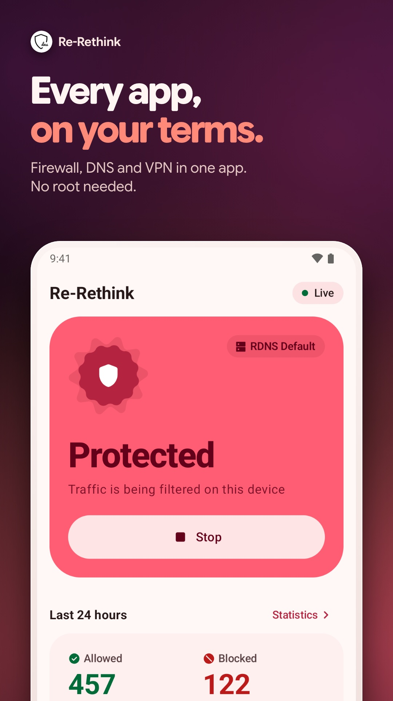
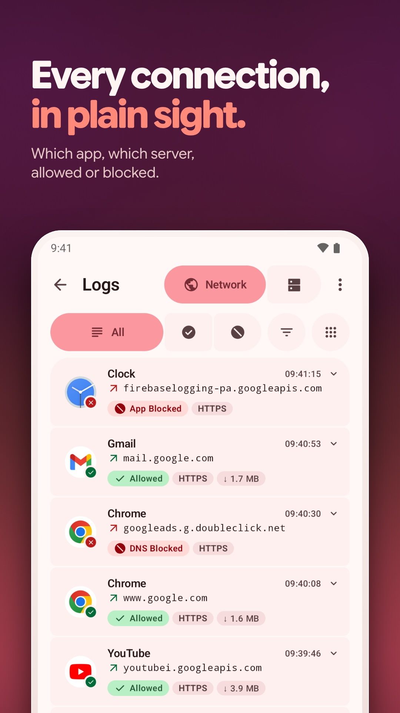
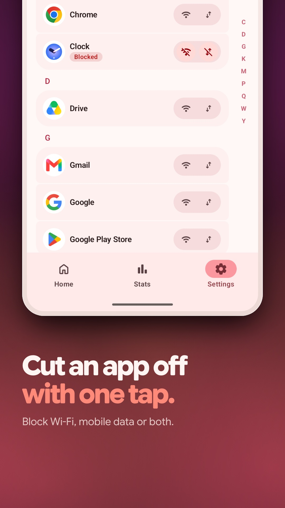
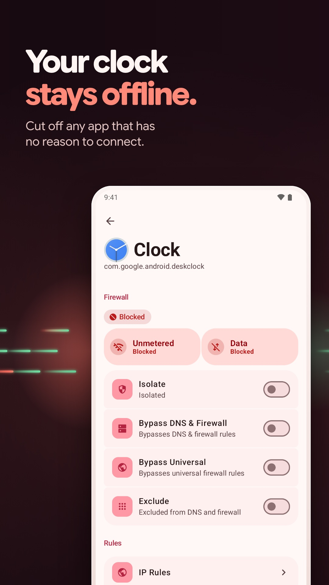
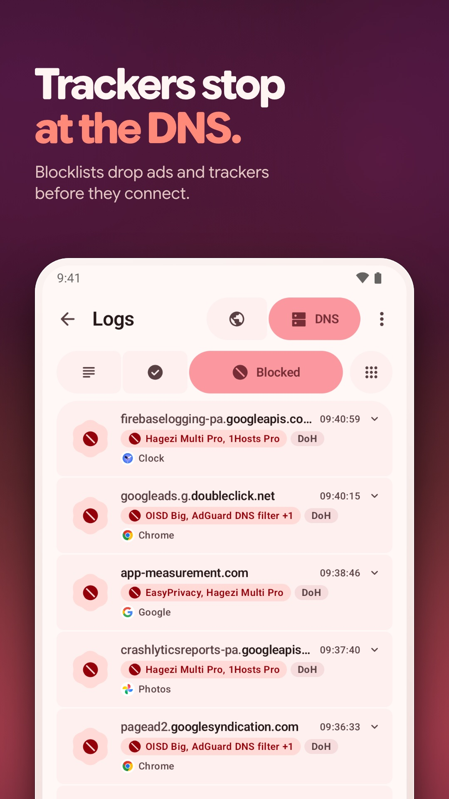
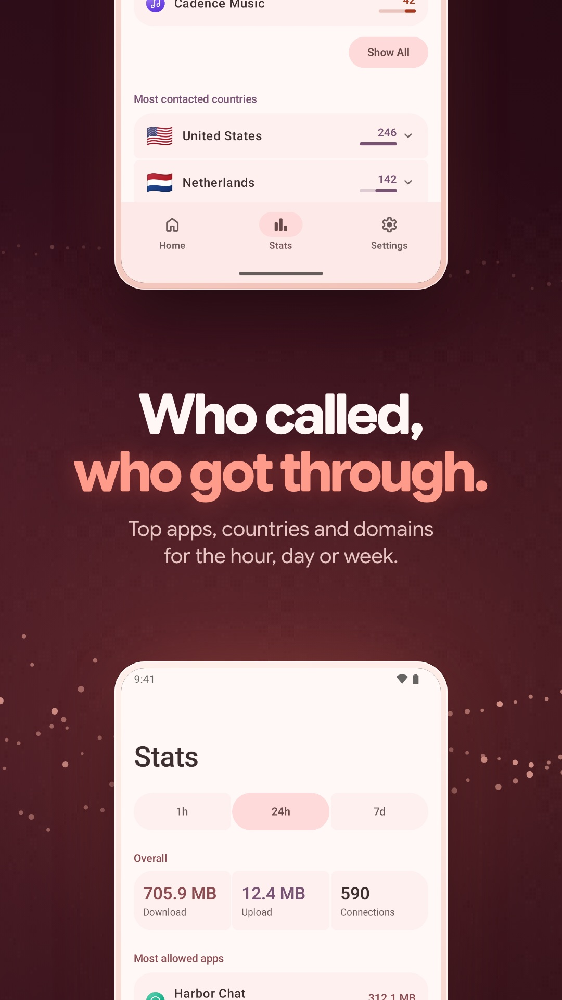
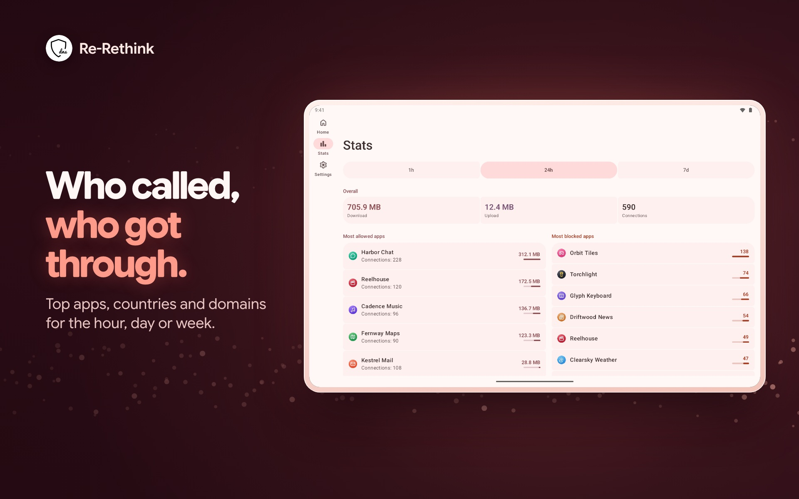

  

<h1 align="center">Re-Rethink</h1>

<strong>Every app, on your terms.</strong>

A no-root firewall, encrypted DNS and VPN for Android. Block apps on Wi-Fi or mobile data, stop trackers before they connect, and see every connection your phone makes.

  

  
  &nbsp;&nbsp;
  

## Your network, app by app

<table>
  <tr>
    <td width="25%"></td>
    <td width="25%"></td>
    <td width="25%"></td>
    <td width="25%"></td>
  </tr>
</table>

- **A firewall for every app.** Block Wi-Fi, mobile data or both with one tap, isolate an app, or add IP and domain rules. Universal rules cover apps in the background, with the screen off, or freshly installed.
- **Encrypted DNS that blocks trackers.** Use Rethink DNS with on-device blocklists, or your own resolver over DNS-over-HTTPS, DNS-over-TLS, DNSCrypt or ODoH.
- **Logs you can read.** Every connection and DNS query shows the app, the server, the country and whether it got through, with statistics for the hour, day or week.

## On a bigger screen

Statistics, logs and rules spread out on tablets and foldables, with a navigation rail beside them.

  

## Private by design

Re-Rethink filters on the device through Android's `VpnService`. Connections go straight to where they were headed, unless you route them through a WireGuard peer or proxy of your own; DNS goes to the resolver you pick, Rethink DNS by default. Logs stay on the phone and can be turned off, and there are no ads. Android allows one VPN at a time, so Re-Rethink takes the place of any other VPN app.

Re-Rethink is a fork of [Rethink DNS + Firewall + VPN](https://github.com/celzero/rethink-app) by Celzero, redesigned with Jetpack Compose and Material 3 Expressive, and stays under the [Apache License 2.0](LICENSE). The tunnel runs on Celzero's [firestack](https://github.com/celzero/firestack).

Building from source or contributing? See [docs/DEVELOPMENT.md](docs/DEVELOPMENT.md).
