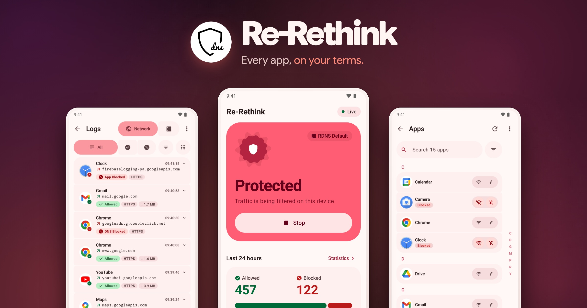
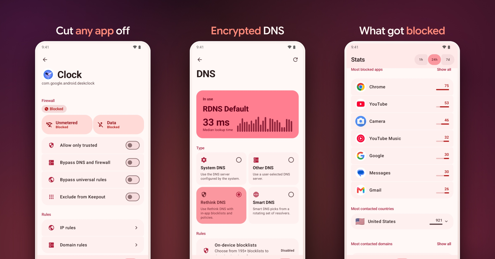
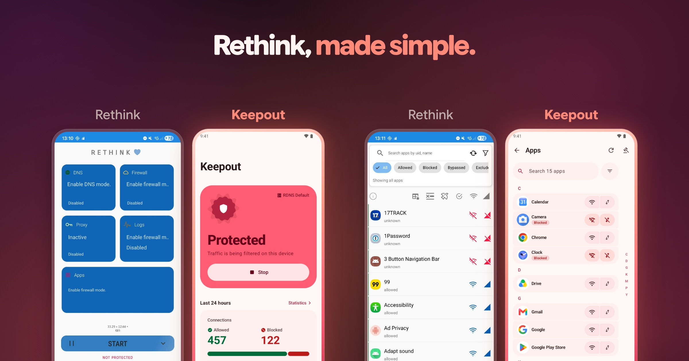
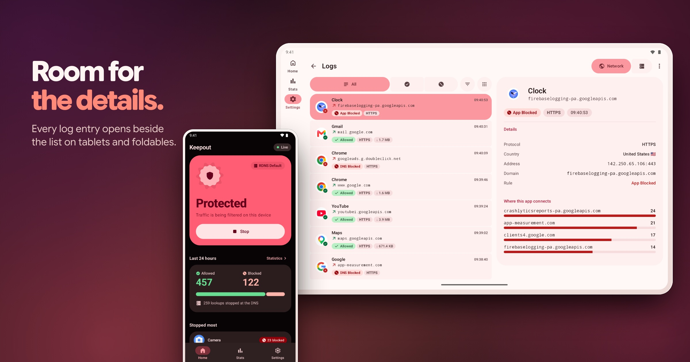

<h1 align="center">
  
</h1>

<strong>See every connection. Stop the ones you didn't ask for.</strong>

A no-root firewall, encrypted DNS and VPN for Android. Block any app on Wi-Fi or mobile data, stop trackers before they connect, and read where each app went.

  

## Your network, app by app

  

- **A firewall for every app.** Block Wi-Fi, mobile data or both with one tap, isolate an app, or add IP and domain rules. Universal rules cover apps in the background, with the screen off, or freshly installed.
- **Encrypted DNS that blocks trackers.** Use Rethink DNS with on-device blocklists, or your own resolver over DNS-over-HTTPS, DNS-over-TLS, DNSCrypt or ODoH.
- **Logs you can read.** Every connection and DNS query shows the app, the server, the country and whether it got through, with statistics for the hour, day or week.

## From Rethink to Re-Rethink

Home trades four mode cards for one clear state, one action and what the firewall did today. The app list trades its icon strip and filter chips for search, sections and a Wi-Fi and mobile data switch pair on every app.

  

Re-Rethink is a fork of [Rethink DNS + Firewall + VPN](https://github.com/celzero/rethink-app) by Celzero, redesigned with Jetpack Compose and Material 3 Expressive, and stays under the [Apache License 2.0](LICENSE). The tunnel runs on Celzero's [firestack](https://github.com/celzero/firestack).

## On a bigger screen

  

## Private by design

- **It all happens on your phone.** Re-Rethink filters through Android's `VpnService`; connections go straight to where they were headed, unless you route them through a WireGuard peer or proxy of your own.
- **DNS goes where you choose.** Rethink DNS by default, or any resolver you pick.
- **Your logs stay yours.** They never leave the phone, you can turn them off, and there are no ads.

Android allows one VPN at a time, so Re-Rethink takes the place of any other VPN app.

Building from source or contributing? See [docs/DEVELOPMENT.md](docs/DEVELOPMENT.md).
